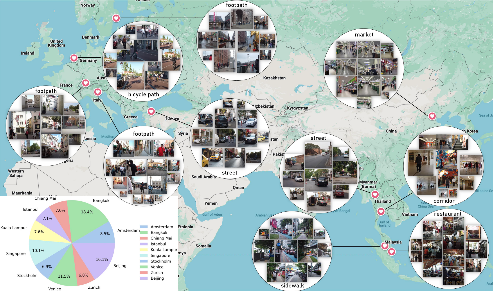
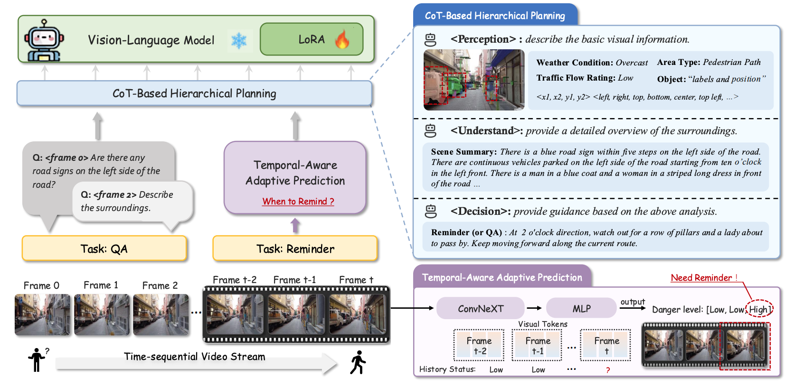

# WalkVLM: Aid Visually Impaired People Walking by Vision-Language Model
<p align="left">
  📄 <a href="https://arxiv.org/pdf/2412.20903" target="_blank"><b>View the Paper (WalkVLM)</b></a>
</p>

## 🔥 Latest Updates

| Timeline | Project | Description |
|---|---|---|
| 📄 2024.12 | **WalkVLM** | CoT-based hierarchical planning + temporal-aware adaptive prediction. First large-scale WAD dataset (12k video–annotation pairs). *(arXiv:2412.20903)* |
| 📄 2025.08 | **[WalkVLM-LR](./WalkVLM-LR/)** | Legacy research snapshot with EAD and human-preference rewards. Kept for reference, but no longer the recommended reproducibility path. |
| 🆕 2026.01 | **[WalkStream](./WalkStream/)** | Data & reward-enhanced low-latency VLM. 98k WRD clips, GRPO-based reward inference, decoupled async architecture — **52.6% latency reduction**. *(IJCV submitted)* |

## ✅ Reproducibility at a glance

| Component | Status | Recommended for a fresh checkout? | Entry |
|---|---|---|---|
| **WalkStream** | Maintained path | **Yes** | [`WalkStream/README.md`](./WalkStream/README.md) |
| **WAD dataset** | Public download script | **Yes** | [`wad_dataset/README.md`](./wad_dataset/README.md) |
| **WRD dataset** | Public download script | **Yes** | [`WalkStream/src/wrd_dataset/README.md`](./WalkStream/src/wrd_dataset/README.md) |
| **WalkVLM-LR** | Archived research snapshot | No | [`WalkVLM-LR/README.md`](./WalkVLM-LR/README.md) |

## 🚀 Recommended quickstart

If you are new to this repository, start from the maintained `WalkStream` path instead of the archived `WalkVLM-LR` files.

```bash
# Clone and enter the repository
git clone git@github.com:xiaoyuan1996/walkvlm.git
cd walkvlm

# Create an isolated Python environment
python -m venv .venv
source .venv/bin/activate
pip install --upgrade pip setuptools wheel

# Install the maintained WalkStream stack
cd WalkStream/src/reminder_generation
pip install -e .

# Basic smoke tests for the supported entrypoints
cd ../otp
python train.py --help
python inference.py --help
python test.py --help
```

For a complete walkthrough, including data download and training commands, continue with [`WalkStream/README.md`](./WalkStream/README.md).

> [!NOTE]
> Full GRPO training in `WalkStream/src/reminder_generation` is intended for **Linux + NVIDIA GPU + CUDA + DeepSpeed**. macOS / Windows can still inspect the code and run lightweight CLI checks, but are not the primary training target.

##  🚀 Introduction

Approximately **200 million individuals worldwide** suffer from varying degrees of visual impairment, making it crucial to leverage AI technology to provide **walking assistance**.

With the recent progress of **vision-language models (VLMs)**, applying them for walking guidance has become increasingly popular. However:

- Existing methods are mainly based on **self-curated QA datasets** that are **not publicly accessible**, lacking a **standardized benchmark**.
- Walking assistance often requires **real-time video analysis** and **concise, informative reminders**, but current VLMs struggle due to **long responses** and **low inference efficiency**.

✨ **Our contributions**:
1. We introduce the **first large-scale walking assistance dataset**, comprising **12,000 video–annotation pairs**, serving as a unified benchmark for training and evaluation.
2. We propose **WalkVLM**, which:
   - Employs **chain-of-thought hierarchical planning** to generate concise but informative reminders.
   - Utilizes **temporal-aware adaptive prediction** to reduce redundancy in reminders.
3. We establish a **solid benchmark** for the blind walking task and verify the advantages of WalkVLM in **streaming video processing** compared to other VLMs.

---

## 🛰️ Method & Dataset

<div align="center">
  
  <div style="width:85%; text-align:justify; margin-top:6px;">
    <b>Fig. 1 —</b> Visualization results of the WAD dataset sorted by region. The WAD dataset has a wide range of sources, and the categories shown are randomly sampled from the dataset. The pie chart in the lower-left corner shows the proportion of video length from different regions.
  </div>
</div>

<div align="center">
  
  <div style="width:85%; text-align:justify; margin-top:6px;">
    <b>Fig. 2 —</b> An overview of the proposed <i>WalkVLM</i> framework. WalkVLM employs CoT-based hierarchical planning to summarize the static attributes and understanding of scenes, thereby facilitating the subsequent reminder and QA tasks. Furthermore, temporal-aware adaptive prediction has been proposed to calculate the trigger state of VLM, thereby reducing the temporal redundancy of outputs.
  </div>
</div>

## 📂 Code structure

```text
.
├── wad_dataset               # Public WAD dataset helper scripts and extracted data
├── WalkVLM-LR                # Legacy research snapshot (archived entrypoints)
│   ├── checkpoint            # Pretrained weights for archived LR experiments
│   ├── vlm_grpo_template     # Archived GRPO template (kept for reference)
│   ├── EAD.py                # EAD model definition
│   ├── inference.py          # Archived inference wrapper
│   ├── test.py               # Archived evaluation wrapper
│   └── train_EAD.py          # Legacy EAD training artifact
└── WalkStream                # Maintained low-latency pipeline
    └── src/
        ├── checkpoint/       # Optional pretrained checkpoint download helper
        ├── infer/            # GPTScore helper
        ├── otp/              # Online Triggered Prediction module
        ├── reminder_generation/  # Maintained GRPO training path
        └── wrd_dataset/      # WRD dataset download helper
```

## 📖 Citation

If you find this repository useful, please cite:

```text
Z. Yuan et al., "WalkVLM: Aid Visually Impaired People Walking by Vision Language Model," arXiv preprint arXiv:2412.20903, Dec. 30, 2024.
```
